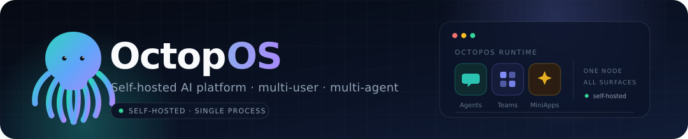

<p align="center">
  
</p>

<p align="center">
  <strong>Self-hosted, multi-user, multi-agent AI platform — one process, your data.</strong>
</p>

<p align="center">
  <a href="https://www.python.org/downloads/"></a>
  <a href="https://github.com/TencentCloud/Octop/blob/main/LICENSE"></a>
  <a href="https://github.com/TencentCloud/Octop/releases"></a>
  <a href="https://pypi.org/project/octop/"></a>
  <a href="https://github.com/astral-sh/ruff"></a>
  <a href="https://discord.gg/QnWdhJxq9h"></a>
</p>

<p align="center">
  <a href="#what-is-octop">What is Octop</a> ·
  <a href="#highlights">Highlights</a> ·
  <a href="#quick-start">Quick Start</a> ·
  <a href="#architecture">Architecture</a> ·
  <a href="#status-and-roadmap">Status</a> ·
  <a href="#documentation">Docs</a> ·
  <a href="#contributing">Contributing</a>
</p>

<p align="center">
  <b>English</b> · <a href="README_CN.md">中文</a>
</p>

---

## What is Octop?

Octop is an open-source, self-hosted AI platform for individuals, teams, and small businesses. One Python process serves the Web dashboard, CLI, IM channels, cron jobs, and the agent runtime. SQLite is the default control-plane database; PostgreSQL is optional. There is no external queue or required service beyond the LLM provider you configure.

The current focus is a **single-node business AgentOS**: agents and teams execute bounded goals with approvals and guardrails, MiniApps turn their output into usable data interfaces, and the desktop shell gives users a shared workspace. This is a deliberate scope: **one instance per team or customer**, not a multi-tenant SaaS cluster.

## Highlights

- **Multi-user, multi-agent by default** — JWT auth, per-user agents and workspaces, an expert library, and team orchestration for multi-step work.
- **MiniApps** — agents create schema-backed data tables and single-file HTML interfaces that run in a sandboxed iframe, with page capabilities, publishing, backup, and a workspace desktop.
- **One inbox for every channel** — Feishu, DingTalk, WeCom, WeChat, QQ, Telegram, Discord, the Web dashboard, CLI, and HTTP/SSE/WebSocket APIs share one agent runtime.
- **Connectors and MCP** — OAuth connectors and an MCP gateway connect external services without putting credentials in agent workspaces.
- **Knowledge, memory, skills, plugins** — RAG over private documents, portable agent memory, installable skills, and third-party plugins.
- **Self-hosted operations** — setup wizard, TLS / Let's Encrypt, systemd/launchd services, backups, in-place updates, and `~/.octop/` as the single data root.
- **Pluggable workspace backends** — local disk, Docker sandbox, COS/S3, and other remote stores behind one `BackendWorkspace` abstraction.
- **ACP in both directions** — expose an agent to IDE/terminal clients, or delegate coding work to external runners such as Claude Code and OpenCode.

<p align="center">
  
</p>

## Quick Start

**Prerequisites:** macOS, Linux, or Windows; no system Python required. The installer provisions Python 3.12 in an isolated environment under `~/.octop/`. A modern multi-core machine with a few GB of RAM is recommended.

### Install

**macOS / Linux**

```bash
curl -fsSL https://finnie-1258344699.cos.ap-guangzhou.myqcloud.com/octop/install.sh | bash
```

**Windows (PowerShell)**

```powershell
irm https://finnie-1258344699.cos.ap-guangzhou.myqcloud.com/octop/install.ps1 | iex
```

**PyPI** (if you manage Python yourself)

```bash
pip install octop
```

See [scripts/README.md](scripts/README.md) for `--version`, `--from-source`, `--mirror`, browser extras, and Windows options.

### Initialize and run

```bash
octop init     # creates ~/.octop/, the SQLite database, JWT secret, and the first admin
octop run      # serves the API and Web dashboard
```

Open **http://127.0.0.1:8088**. Use a custom host/port with `octop run --host 0.0.0.0 --port 8088`, or register a service with `octop service start`.

### Docker

```bash
docker compose -f docker/docker-compose.yml up -d
# China mirror when ghcr.io is unreachable:
docker compose -f docker/docker-compose.cn.yml up -d
```

With Docker, a valid `OCTOP_DEFAULT_PASSWORD` creates the admin on first boot and writes credentials to `/data/.octop/credential.txt`; otherwise complete the setup wizard using the unlock password in `/data/.octop/octop-login.txt`. See [`.env.example`](.env.example) for `OCTOP_PORT`, `OCTOP_DATA`, PostgreSQL, and other variables.

Native desktop clients (Windows / macOS / Linux) and FnOS packages are available from [GitHub Releases](https://github.com/TencentCloud/Octop/releases/latest).

## What you can do

| Scenario | What Octop provides |
|---|---|
| Personal assistant | A persistent agent with memory, scheduled jobs, and IM access |
| Team / business operations | Experts and teams that plan, dispatch, execute, and record work |
| Data collection and review | MiniApps with tables, forms, publishing, and read-only public links |
| Customer-facing IM | Feishu / DingTalk / WeCom / WeChat / Telegram / Discord routing per expert |
| Automation | Cron jobs, external webhooks, and connector polling |
| Development | ACP delegation to coding agents, terminal AI, and a browser automation runtime |
| Remote work | Optional remote desktop and browser sessions from the dashboard |

## Architecture

```text
Dashboard / CLI / IM channels / cron / external events
                         │
                  FastAPI + WebSocket
                         │
                    OctopServer
       ┌─────────────────┼──────────────────┐
       │                 │                  │
  AgentManager       Gateway             Cron / events
  (per-agent         (IM channels,       (schedules,
   harness runtime)   WS hub)             deliveries)
       │                 │                  │
       └─────────────────┼──────────────────┘
                         │
             SharedServices / RepoBundle
                         │
        SQLite (default) or PostgreSQL
        + per-agent workspaces (local / Docker / COS / S3)
```

The agent loop, IM gateway, memory, and browser runtime are separate packages — [Octop Harness](https://github.com/TencentCloud/octop-harness), [Octop Gateway](https://github.com/TencentCloud/octop-gateway), [Octop Memory](https://github.com/TencentCloud/octop-memory), and [Octop Browser](https://github.com/TencentCloud/octop-browser). Octop composes them into one process and rebuilds runtime state from the control-plane database on boot.

See [docs/architecture.md](docs/architecture.md) and the ADRs for the single-process and dual-database decisions:
[docs/adr/001-single-process-model.md](docs/adr/001-single-process-model.md),
[docs/adr/002-database-backends.md](docs/adr/002-database-backends.md).

## Web dashboard and CLI

The dashboard covers chat, experts and teams, MiniApps and the workspace desktop, connectors, channels, cron, knowledge, plugins, security, and settings. Interactive API docs are served at **`/api/docs`** when `"enable_api_docs": true` is set in `config.json` (disabled by default).

| Command | Purpose |
|---|---|
| `octop init` | Bootstrap `~/.octop/` (database, admin, JWT secret) |
| `octop run` | Start the API and dashboard in the foreground |
| `octop service start` | Install and start as a system service |
| `octop agent` | Create, list, start/stop, and reload agents |
| `octop chats` | Chat REPL and session management |
| `octop channel` | Install and manage IM channels |
| `octop cron` | Manage scheduled jobs |
| `octop provider` / `octop models` | Configure LLM providers and active models |
| `octop acp` | Expose an agent over the Agent Client Protocol |
| `octop backup` | Export or restore local data |
| `octop update` | Update the wheel and restart the service |

Full reference: [docs/cli.md](docs/cli.md). API reference: [docs/api.md](docs/api.md).

## Configuration and data

```text
~/.octop/
├── config.json                 # process config (optional database section)
├── octop.db                    # SQLite control plane
├── secrets/                    # JWT secret, channel tokens
├── agents/<agent_id>/          # per-agent workspace (SOUL.md, skills, …)
├── security/tool_guard/        # shell command guard rules
├── logs/                       # runtime logs
├── venv/                       # installer-managed Python
└── bin/octop                   # PATH wrapper
```

PostgreSQL can replace SQLite for the control plane via `config.json`, `OCTOP_DATABASE_*`, or the setup wizard. Agent memory and workspace files are separate layers; see [docs/configuration.md](docs/configuration.md) and [docs/adr/002-database-backends.md](docs/adr/002-database-backends.md).

## Security and privacy

- **Local-first by default** — conversations, workspaces, credentials, and configuration live under `~/.octop/`.
- **Multi-user isolation** — JWT authentication, per-user agents, and workspace ownership checks.
- **Approvals and guardrails** — tool-level HITL approval, shell command guard rules, and PII redaction for outbound/read-only surfaces.
- **No credential exposure to MiniApp pages** — page code runs in a sandboxed iframe without a JWT; external I/O is proxied by the host under a capability manifest.
- **Optional isolation** — Docker sandbox backends are available per agent; the default single-user setup is optimized for a trusted machine.
- **Deployment boundary** — Octop is a single-node platform. It does not provide multi-tenant process isolation, a distributed kernel, or an external queue. Run one instance per customer or team when isolation is required.

## Status and roadmap

Current release: **1.0.2**. Octop is a usable single-node agent platform; the **business AgentOS** direction is still in progress in the current source tree.

**In the current source tree**

- Multi-user agents, experts, teams, and workspace isolation.
- MiniApps: schema-backed tables, sandboxed HTML pages, capability manifests, publishing, backup, and the desktop shell.
- IM channels, connectors/MCP, knowledge bases, memory, skills, plugins, and cron.
- Durable desktop notification inbox for access requests and HITL approvals; hidden-window resource governance.

**Next (Route A: single-node business AgentOS)**

- Capability contracts, boundary policy (allow / approve / deny), and capability-level audit.
- Execution envelope and supervision: per-agent concurrency, timeouts, resource limits, restart visibility.
- Event-plane correctness and unified scheduling / backpressure.
- Hard budget gates across all LLM paths.
- MiniApp data history, references, query pushdown, and application packages.
- End-to-end tracing, metrics export, cost accounting, and readiness.

**Not in current scope**

- Multi-tenant SaaS clusters, distributed scheduling, or a general-purpose plugin runtime.
- A universal event bus; Octop deliberately uses five documented event planes with at-least-once delivery.

See [docs/agent-os-roadmap.md](docs/agent-os-roadmap.md) and [docs/agent-os-status-review.md](docs/agent-os-status-review.md) for the full plan and known gaps.

## Development

**Prerequisites:** Python 3.12+, Node 18+, [uv](https://docs.astral.sh/uv/).

```bash
make install          # install backend dev dependencies
make install-hooks    # enable the repo's pre-commit hook (make all + dashboard build)
make all              # format-all + lint + typecheck + test (ship bar)

make dev              # backend + Vite dev server
make dev-frontend     # Vite dev server only
make build-frontend   # dashboard/ → src/octop/dashboard/
cd dashboard && npx tsc -b
```

Targeted tests: `uv run pytest tests/unit -q -x`, `uv run pytest tests/integration -q -x`. CI runs on Linux and Windows; do not hard-code POSIX-only paths in tests.

## Documentation

| Topic | Entry point |
|---|---|
| Architecture and ADRs | [docs/architecture.md](docs/architecture.md) |
| API reference | [docs/api.md](docs/api.md) |
| CLI reference | [docs/cli.md](docs/cli.md) |
| Configuration and data directory | [docs/configuration.md](docs/configuration.md) |
| Connectors and OAuth/MCP | [docs/connectors.md](docs/connectors.md) |
| MiniApps | [docs/miniapp-overview.md](docs/miniapp-overview.md) |
| AgentOS roadmap | [docs/agent-os-roadmap.md](docs/agent-os-roadmap.md) |
| Current status and gaps | [docs/agent-os-status-review.md](docs/agent-os-status-review.md) |
| ACP integration | [docs/acp.md](docs/acp.md) |
| Expert teams | [docs/expert-teams.md](docs/expert-teams.md) |
| Contributor conventions | [AGENTS.md](AGENTS.md) |

## Contributing

Contributions are welcome:

1. Fork the repository and create a branch from `develop`.
2. Keep changes surgical; follow [AGENTS.md](AGENTS.md) for module boundaries and i18n rules.
3. Run `make all` (backend) and `cd dashboard && npx tsc -b` (frontend) before opening a PR.
4. Open the PR into `develop`, not `main`.

Security issues: see [SECURITY.md](SECURITY.md). Release history: [CHANGELOG.md](CHANGELOG.md).

## Community

- Discord: [discord.gg/QnWdhJxq9h](https://discord.gg/QnWdhJxq9h)
- WeCom customer group (CN):

<p align="center">
  
</p>

## License

[MIT](LICENSE). Thanks to all contributors:

<a href="https://github.com/tencentcloud/octop/graphs/contributors">
  
</a>
