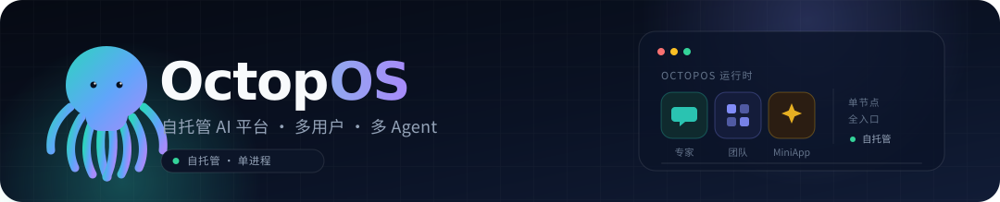

<p align="center">
  
</p>

<p align="center">
  <strong>自托管、多用户、多 Agent 的 AI 平台——单进程运行，数据留在本机。</strong>
</p>

<p align="center">
  <a href="https://www.python.org/downloads/"></a>
  <a href="https://github.com/yueshi/OctopOS/blob/main/LICENSE"></a>
  <a href="https://github.com/yueshi/OctopOS/releases"></a>
  <a href="https://pypi.org/project/octop/"></a>
  <a href="https://github.com/astral-sh/ruff"></a>
  <a href="https://discord.gg/QnWdhJxq9h"></a>
</p>

<p align="center">
  <a href="#什么是-octop">什么是 OctopOS</a> ·
  <a href="#亮点">亮点</a> ·
  <a href="#快速开始">快速开始</a> ·
  <a href="#架构">架构</a> ·
  <a href="#状态与路线图">状态</a> ·
  <a href="#文档">文档</a> ·
  <a href="#参与贡献">参与贡献</a>
</p>

<p align="center">
  <a href="README.md">English</a> · <b>中文</b>
</p>

---

## 什么是 OctopOS？

OctopOS 是一个开源、自托管的 AI 平台，面向个人、团队与小企业。一个 Python 进程同时提供 Web 控制台、CLI、IM 通道、定时任务与 Agent 运行时。控制面默认使用 SQLite，可选 PostgreSQL；除你配置的 LLM 供应商外，不依赖外部队列或必需服务。

当前聚焦的是**单节点业务 AgentOS**：Agent 与团队在边界内执行目标，经过审批与防护规则；MiniApp 把交付物变成可用的数据界面；桌面 Shell 提供统一工作台。这个边界是刻意的：**每个团队/客户一个实例**，不是多租户 SaaS 集群。

**命名说明：** 产品名为 OctopOS；Python 包、CLI 命令（`octop`）、数据目录（`~/.octop/`）与 `OCTOP_*` 环境变量为兼容性保留原名。

## 亮点

- **默认多用户、多 Agent** — JWT 认证、每用户独立 Agent 与工作区、专家库，以及面向多步骤任务的团队编排。
- **MiniApp** — Agent 创建带 schema 的数据表与单文件 HTML 界面，运行在沙箱 iframe 中，支持页面能力清单、发布、备份与桌面工作台。
- **全通道统一入口** — 飞书、钉钉、企业微信、微信、QQ、Telegram、Discord、Web 控制台、CLI，以及 HTTP/SSE/WebSocket API 共享同一套 Agent 运行时。
- **Connector 与 MCP** — 通过 OAuth 与 MCP 网关接入外部服务，凭据不进入 Agent 工作区。
- **知识库、记忆、技能、插件** — 私有文档 RAG、可迁移的 Agent 记忆、可安装技能与第三方插件。
- **自托管运维** — 首启向导、TLS / Let's Encrypt、systemd/launchd 服务、备份、原地升级，数据统一放在 `~/.octop/`。
- **可插拔工作区后端** — 本地磁盘、Docker 沙箱、COS/S3 等远程存储，统一走 `BackendWorkspace` 抽象。
- **ACP 双向集成** — 把 Agent 暴露给 IDE/终端客户端，或在对话中委派 Claude Code、OpenCode 等外部编码 Agent。

## 快速开始

**环境要求：** macOS、Linux 或 Windows；无需预装 Python。安装脚本会在 `~/.octop/` 下创建隔离环境并准备 Python 3.12。建议使用现代多核 CPU 与数 GB 内存。

### 安装

**macOS / Linux**

```bash
curl -fsSL https://finnie-1258344699.cos.ap-guangzhou.myqcloud.com/octop/install.sh | bash
```

**Windows（PowerShell）**

```powershell
irm https://finnie-1258344699.cos.ap-guangzhou.myqcloud.com/octop/install.ps1 | iex
```

**PyPI**（自行管理 Python 时）

```bash
pip install octop
```

`--version`、`--from-source`、`--mirror`、浏览器扩展与 Windows 选项见 [scripts/README.md](scripts/README.md)。

### 初始化并启动

```bash
octop init     # 创建 ~/.octop/、SQLite 数据库、JWT 密钥与首个管理员
octop run      # 启动 API 与 Web 控制台
```

打开 **http://127.0.0.1:8088**。可用 `octop run --host 0.0.0.0 --port 8088` 指定监听地址，或用 `octop service start` 注册为系统服务。

### Docker

```bash
docker compose -f docker/docker-compose.yml up -d
# ghcr.io 不可用时使用国内源：
docker compose -f docker/docker-compose.cn.yml up -d
```

Docker 下，有效的 `OCTOP_DEFAULT_PASSWORD` 会在首次启动时创建管理员，凭据写入 `/data/.octop/credential.txt`；否则打开首启向导，使用 `/data/.octop/octop-login.txt` 中的解锁密码完成初始化。`OCTOP_PORT`、`OCTOP_DATA`、PostgreSQL 等变量见 [`.env.example`](.env.example)。

Windows / macOS / Linux 原生桌面客户端与飞牛（FnOS）安装包见 [GitHub Releases](https://github.com/yueshi/OctopOS/releases/latest)。

## 你可以用它做什么

| 场景 | OctopOS 提供什么 |
|---|---|
| 个人助理 | 带记忆、定时任务与 IM 入口的长期 Agent |
| 团队 / 业务经营 | 专家与团队规划、派发、执行并记录工作 |
| 数据采集与审核 | MiniApp 表格、表单、发布与只读公开链接 |
| 客户侧 IM | 按专家路由的飞书 / 钉钉 / 企业微信 / 微信 / Telegram / Discord |
| 自动化 | 定时任务、外部 webhook 与连接器轮询 |
| 开发协作 | ACP 委派编码 Agent、终端 AI 与浏览器自动化 |
| 远程办公 | 从控制台使用可选远程桌面与浏览器会话 |

## 架构

```text
用户 / 团队
  ├─ Web 控制台：桌面 Shell + MiniApp + 通知
  ├─ CLI
  ├─ IM 通道
  └─ HTTP / WebSocket / webhook
                         │
                  FastAPI + WebSocket
                         │
                    OctopServer
       ┌─────────────────┼──────────────────┐
       │                 │                  │
  AgentManager       Gateway             Cron / events
  （octop-harness，   （IM 通道、          （调度、
   每 Agent 运行时）    WS hub）             投递）
       │
       ├─ Provider / 工具 / 技能 / 记忆
       └─ 每 Agent 工作区（本地 / Docker / COS / S3）
                         │
             SharedServices / RepoBundle
                         │
        SQLite（默认）或 PostgreSQL
```

Agent 循环、IM 网关、记忆与浏览器运行时是独立包：[Octop Harness](https://github.com/TencentCloud/octop-harness)、[Octop Gateway](https://github.com/TencentCloud/octop-gateway)、[Octop Memory](https://github.com/TencentCloud/octop-memory)、[Octop Browser](https://github.com/TencentCloud/octop-browser)。OctopOS 把它们组合进一个进程，并在启动时从控制面数据库重建运行时状态。

详见 [docs/architecture.md](docs/architecture.md) 与 ADR：
[docs/adr/001-single-process-model.md](docs/adr/001-single-process-model.md)、
[docs/adr/002-database-backends.md](docs/adr/002-database-backends.md)。

## Web 控制台与 CLI

控制台覆盖对话、专家与团队、MiniApp 与桌面工作台、Connector、通道、定时任务、知识库、插件、安全与系统设置。交互式 API 文档位于 **`/api/docs`**，需在 `config.json` 设置 `"enable_api_docs": true`（默认关闭）。

| 命令 | 用途 |
|---|---|
| `octop init` | 初始化 `~/.octop/`（数据库、管理员、JWT 密钥） |
| `octop run` | 前台启动 API 与控制台 |
| `octop service start` | 安装并启动系统服务 |
| `octop agent` | 创建、列出、启停与重载 Agent |
| `octop chats` | 对话 REPL 与会话管理 |
| `octop channel` | 安装与管理 IM 通道 |
| `octop cron` | 管理定时任务 |
| `octop provider` / `octop models` | 配置 LLM 供应商与当前模型 |
| `octop acp` | 以 Agent Client Protocol 暴露 Agent |
| `octop backup` | 导出或恢复本地数据 |
| `octop update` | 更新 wheel 并重启服务 |

完整参考：[docs/cli.md](docs/cli.md)。API 参考：[docs/api.md](docs/api.md)。

## 配置与数据

```text
~/.octop/
├── config.json                 # 进程配置（可选 database 段）
├── octop.db                    # SQLite 控制面
├── secrets/                    # JWT 密钥、通道 token
├── agents/<agent_id>/          # 每 Agent 工作区（SOUL.md、skills 等）
├── security/tool_guard/        # Shell 命令防护规则
├── logs/                       # 运行日志
├── venv/                       # 安装器管理的 Python
└── bin/octop                   # PATH 包装器
```

控制面可通过 `config.json`、`OCTOP_DATABASE_*` 或首启向导切换到 PostgreSQL。Agent 记忆与工作区文件是独立层；详见 [docs/configuration.md](docs/configuration.md) 与 [docs/adr/002-database-backends.md](docs/adr/002-database-backends.md)。

## 安全与隐私

- **默认本地优先** — 对话、工作区、凭据与配置都在 `~/.octop/`。
- **多用户隔离** — JWT 认证、每用户独立 Agent 与工作区归属校验。
- **审批与防护** — 工具级 HITL 审批、Shell 命令防护规则，以及对外/只读面的 PII 脱敏。
- **MiniApp 不接触凭据** — 页面运行在无 JWT 的沙箱 iframe 中，外部 I/O 由宿主按能力清单代理。
- **可选隔离** — 每个 Agent 可配置 Docker 沙箱；默认单用户环境面向可信机器优化。
- **部署边界** — OctopOS 是单节点平台，不提供多租户进程隔离、分布式内核或外部队列。需要隔离时，每个客户/团队部署一个实例。

## 状态与路线图

当前版本：**1.0.2**。OctopOS 已是可用的单节点 Agent 平台；**业务 AgentOS** 方向在当前源码中继续推进。

**当前源码已具备**

- 多用户 Agent、专家、团队与工作区隔离。
- MiniApp：schema 数据表、沙箱 HTML 页面、能力清单、发布、备份与桌面 Shell。
- IM 通道、Connector/MCP、知识库、记忆、技能、插件与定时任务。
- 访问申请与 HITL 审批的持久通知收件箱；隐藏窗口资源治理。

**下一步（路线 A：单节点业务 AgentOS）**

- 能力合约、边界策略（放行 / 审批 / 拒绝）与能力级审计。
- 执行信封与监督：每 Agent 并发、超时、资源限制、重启可见性。
- 事件平面正确性与统一调度 / 背压。
- 覆盖所有 LLM 路径的预算硬闸门。
- MiniApp 数据历史、引用、查询下推与应用包。
- 端到端 trace、指标导出、成本核算与 readiness。

**当前不做**

- 多租户 SaaS 集群、分布式调度或通用第三方代码运行时。
- 通用 EventBus；OctopOS 刻意使用五类文档化事件平面与至少一次投递。

完整计划与已知缺口见 [docs/agent-os-roadmap.md](docs/agent-os-roadmap.md) 与 [docs/agent-os-status-review.md](docs/agent-os-status-review.md)。

## 开发

**环境要求：** Python 3.12+、Node 18+、[uv](https://docs.astral.sh/uv/)。

```bash
make install          # 安装后端开发依赖
make install-hooks    # 启用仓库 pre-commit（make all + dashboard build）
make all              # format-all + lint + typecheck + test（合并门槛）

make dev              # 后端 + Vite 开发服务器
make dev-frontend     # 仅 Vite 开发服务器
make build-frontend   # dashboard/ → src/octop/dashboard/
cd dashboard && npx tsc -b
```

定向测试：`uv run pytest tests/unit -q -x`、`uv run pytest tests/integration -q -x`。CI 同时覆盖 Linux 与 Windows，测试中不要硬编码 POSIX 路径。

## 文档

| 主题 | 入口 |
|---|---|
| 架构与 ADR | [docs/architecture.md](docs/architecture.md) |
| API 参考 | [docs/api.md](docs/api.md) |
| CLI 参考 | [docs/cli.md](docs/cli.md) |
| 配置与数据目录 | [docs/configuration.md](docs/configuration.md) |
| Connector 与 OAuth/MCP | [docs/connectors.md](docs/connectors.md) |
| MiniApp | [docs/miniapp-overview.md](docs/miniapp-overview.md) |
| AgentOS 路线图 | [docs/agent-os-roadmap.md](docs/agent-os-roadmap.md) |
| 当前状态与缺口 | [docs/agent-os-status-review.md](docs/agent-os-status-review.md) |
| ACP 集成 | [docs/acp.md](docs/acp.md) |
| 专家团队 | [docs/expert-teams.md](docs/expert-teams.md) |
| 贡献者约定 | [AGENTS.md](AGENTS.md) |

## 参与贡献

欢迎贡献：

1. Fork 仓库，从 `develop` 创建分支。
2. 保持改动聚焦；遵循 [AGENTS.md](AGENTS.md) 的模块边界与 i18n 规则。
3. 提交 PR 前运行 `make all`（后端）与 `cd dashboard && npx tsc -b`（前端）。
4. PR 目标分支为 `develop`，不是 `main`。

安全问题见 [SECURITY.md](SECURITY.md)。版本历史见 [CHANGELOG.md](CHANGELOG.md)。

## 社区

- Discord：[discord.gg/QnWdhJxq9h](https://discord.gg/QnWdhJxq9h)
- 客户企业微信群（中文）：

<p align="center">
  
</p>

## 许可证

[MIT](LICENSE)。感谢所有贡献者：

<a href="https://github.com/yueshi/OctopOS/graphs/contributors">
  
</a>
